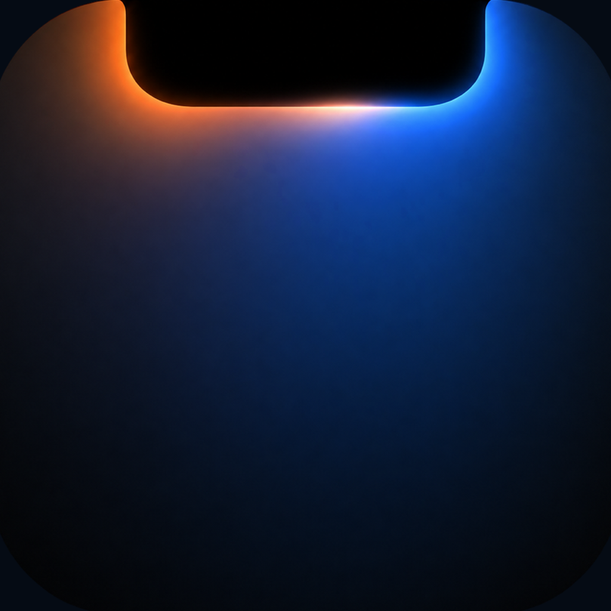
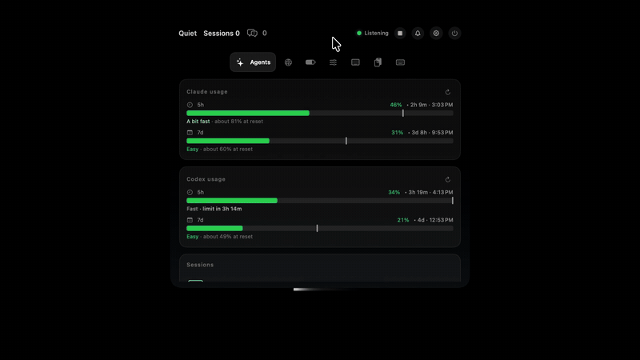

<p align="center">
  
</p>

<h1 align="center">ClangNotch</h1>

<p align="center">
  <a href="README.md">English</a> · 한국어
</p>

<p align="center">
  Claude Code와 Codex가 일하는 걸 맥 노치에서.
</p>

<p align="center">
  
</p>

<p align="center">
  
  
</p>

---

ClangNotch는 노치에 붙어서 코딩 에이전트가 지금 무슨 도구를 돌리는지,응답이 끝났는지, 내 답을 기다리는지 보여 줍니다. Claude Code와 Codex가 원래 남기는 세션 파일을 읽기 때문에 따로 설정하지 않아도됩니다.


## 설치

[Releases](../../releases)에서 `ClangNotch.dmg`를 받아 응용 프로그램 폴더로 끌어다 놓습니다.

공증을 받지 않은 앱이라 처음 실행할 때 macOS가 막습니다. **시스템 설정 → 개인정보 보호 및 보안**에서 **그래도 열기**를 누르면 됩니다.

macOS 14.2 이상이 필요합니다. 노치가 없는 맥에서는 화면 위쪽에 같은 모양으로 뜹니다.

## 기능

**에이전트**

- Claude Code(CLI, 데스크톱 앱, VS Code)와 Codex(CLI, 데스크톱 앱)의 실시간 상태. `~/.claude/projects`와 `~/.codex/sessions`를 읽음
- 닫힌 노치에 지금 도는 도구 표시, 턴이 끝나면 체크 표시와 함께 Done
- 권한 요청과 `AskUserQuestion` 질문에 노치에서 바로 답하기
- 폴더별 세션 목록. 세션을 누르면 단계별 진행과 파일 변경 내용이 보임
- Claude와 Codex의 5시간·주간 사용량
- SSH 서버에서 도는 Claude Code 세션(역방향 터널)
- SSH 서버에서 도는 Codex는 아직 구현하지 않았음

**도구**

펼친 노치의 탭으로 하나씩 들어 있고, 설정에서 끌 수 있습니다.

<p align="center">
  
</p>

- 클립보드 기록(텍스트만, 메모리에만 보관)
- 앱별 볼륨 제어
- iPad 사이드카 조절
- 다중디스플레이 정렬 빠른접근
- 맥, 블루투스 기기, 아이폰·아이패드 배터리
- 속도 측정과 네트워크 정보
- 키보드 잠금

볼륨·밝기 키를 누르면 시스템 표시 대신 ClangNotch 조절창이 뜹니다.

## 권한

| 권한 | 쓰는 곳 |
|---|---|
| 손쉬운 사용 | 볼륨·밝기 키, 키보드 잠금, 시스템 표시 옮기기 |
| 알림 | 배터리 부족 알림 |
| 위치 | Wi-Fi 이름 읽기(macOS가 위치 권한 없이는 안 알려 줌) |
| 오디오 캡처 | 앱별 볼륨 |

노치에서 승인하기를 쓰면 `~/.claude/settings.json`과 `~/.codex/hooks.json`에 훅이 추가되고, 원래 파일은 백업해 둡니다. Codex는 새 훅을 `/hooks`에서 한 번 신뢰해야 실행합니다.

아이폰·아이패드 배터리를 보려면 [libimobiledevice](https://libimobiledevice.org)가 필요합니다. Battery 탭의 설치 버튼을 누르면 터미널에서 `brew install libimobiledevice`를 실행합니다.

## 빌드

```bash
git clone https://github.com/Clang-error/clangnotch.git
cd clangnotch
xcodebuild -project ClangNotch.xcodeproj -scheme ClangNotch -configuration Release build
```

빌드 전에 프로젝트의 Signing 설정에서 본인 개발 팀으로 바꿔 주세요.

## 라이선스

[MIT](LICENSE)
