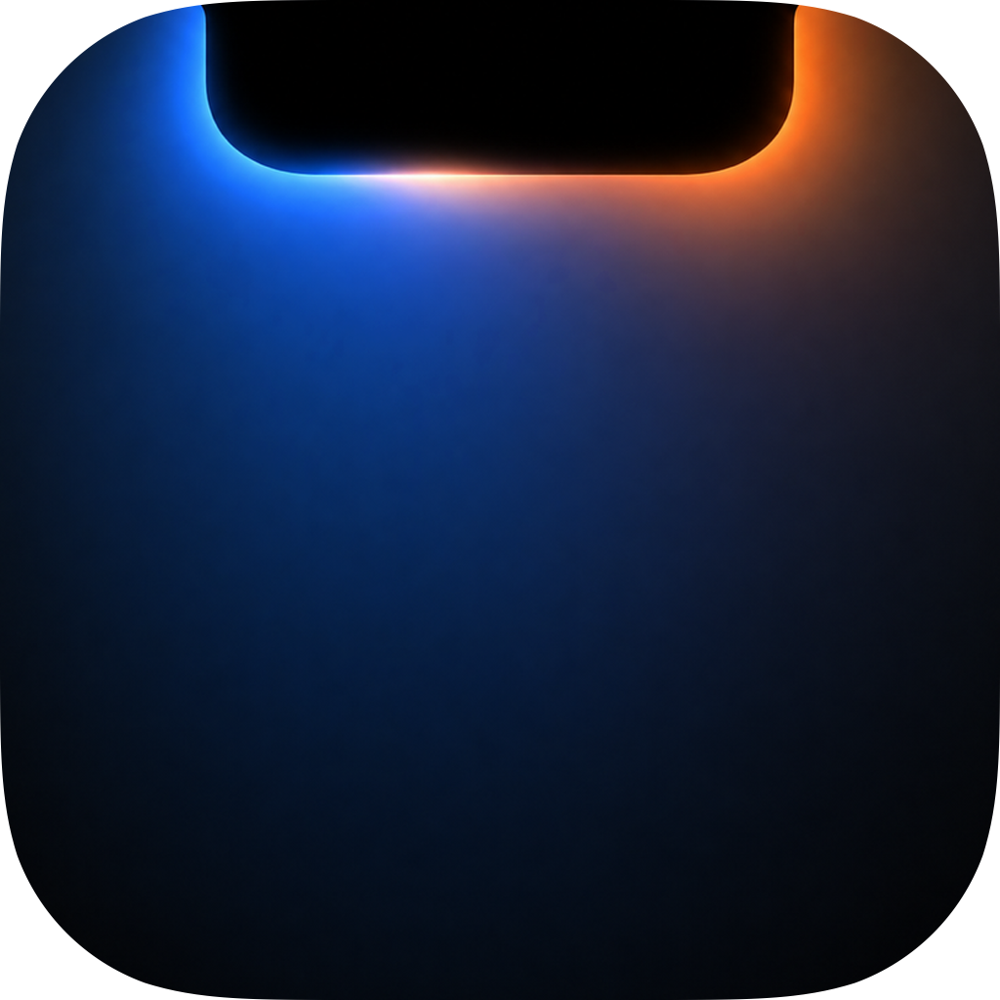
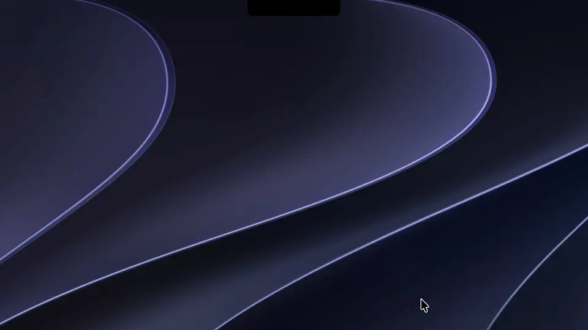
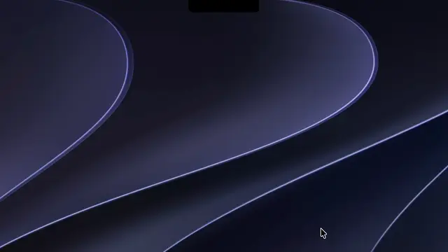
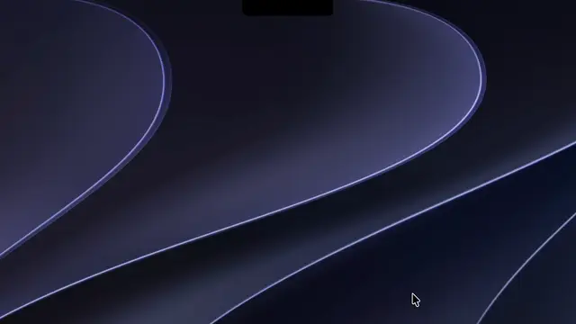
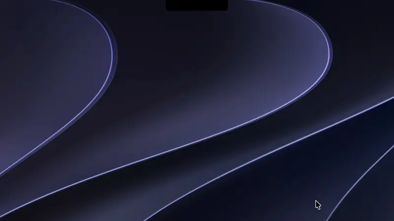
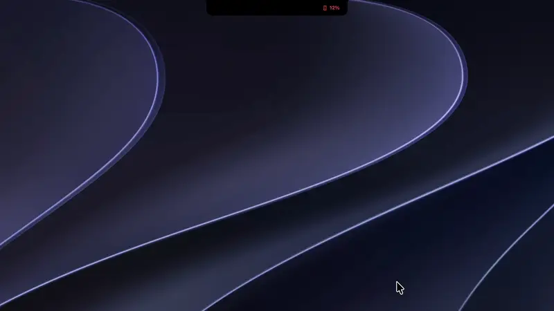
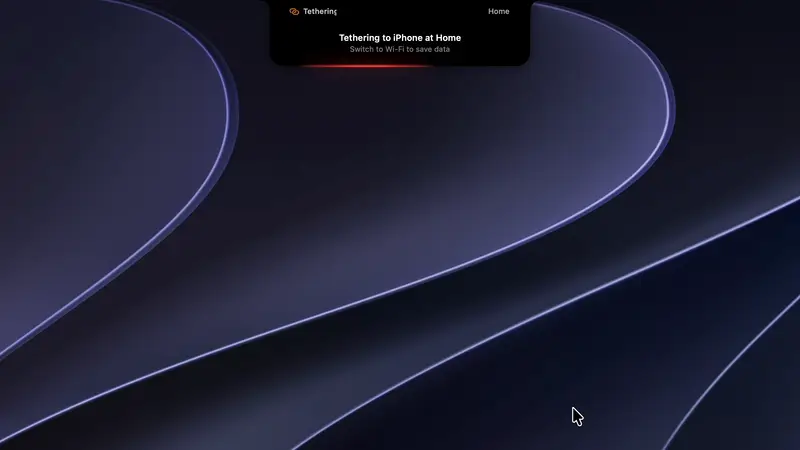

<p align="center">
  
</p>

<h1 align="center">ClangNotch</h1>

<p align="center">
  <a href="README.md">English</a> · 한국어
</p>

<p align="center">
  Claude Code와 Codex가 일하는 걸 맥 노치에서.
</p>

<p align="center">
  
</p>

<p align="center">
  
  
</p>

---

ClangNotch는 노치에 붙어서 코딩 에이전트가 지금 무슨 도구를 돌리는지,응답이 끝났는지, 내 답을 기다리는지 보여 줍니다. Claude Code와 Codex가 원래 남기는 세션 파일을 읽기 때문에 따로 설정하지 않아도됩니다.


## 설치

[Releases](../../releases)에서 `ClangNotch.dmg`를 받아 응용 프로그램 폴더로 끌어다 놓습니다.

Apple 공증을 받은 앱이라 경고 없이 열립니다. 그다음부터는 새 버전을 알아서 받아 두고, **재시작해서 업데이트**(설정 › 정보)를 누르면 설치합니다.

macOS 14.2 이상이 필요합니다. 노치가 없는 맥에서는 화면 위쪽에 같은 모양으로 뜹니다.

## 기능

**에이전트**

- Claude Code(CLI, 데스크톱 앱, VS Code)와 Codex(CLI, 데스크톱 앱)의 실시간 상태. `~/.claude/projects`와 `~/.codex/sessions`를 읽음
- 닫힌 노치에 지금 도는 도구 표시, 턴이 끝나면 체크 표시와 함께 Done
- 끝나면 마지막 답변 첫 줄과 걸린 시간이 내려오고, 터미널 열기·GUI 열기로 그 세션이 도는 터미널 탭이나 앱으로 바로 이동
- 권한 요청과 `AskUserQuestion` 질문에 노치에서 바로 답하기. Codex 질문은 노치에 띄우고 답은 Codex에서
- 답을 기다리는 세션은 3·5·10분마다 다시 알림. 완료음·대기음은 화면이 잠겨 있으면 끔
- 폴더별 세션 목록. 세션을 누르면 세션 화면이 열려 단계별 진행과 파일 변경 내용이 보이고, 거기서 그 세션의 터미널이나 앱으로 이동
- Claude가 띄운 서브에이전트도 세션 아래에 따로 보임. Codex 세션은 Codex 앱의 스레드 이름으로 보임
- 세션 화면 위쪽에 컨텍스트 사용량 막대
- Claude와 Codex의 5시간·주간 사용량
- SSH 호스트에서 도는 Claude Code 세션: 리눅스·맥은 훅과 역방향 터널, 윈도우는 대화 기록을 읽어 옴
- SSH 호스트에서 도는 Codex 세션: 리눅스·맥·윈도우 (호스트의 세션 기록을 읽어 옴, 호스트에 설치하는 것 없음)

**도구**

펼친 노치의 탭으로 하나씩 들어 있고, 설정에서 끌 수 있습니다.

<p align="center">
  
</p>

- 클립보드 기록(텍스트만, 메모리에만 보관). 자주 쓰는 건 고정가능
- 앱별 볼륨 제어
- iPad 사이드카 조절
- 다중디스플레이 정렬 빠른접근
- 맥, 블루투스 기기(서드파티 헤드셋·키보드 포함), 아이폰·아이패드 배터리. 기기 줄을 우클릭해 헤더에 표시하거나 닫힌 노치 순위를 정함
- 순위를 정한 기기가 20% 아래로 떨어지면(충전 중이면 빼고) 닫힌 노치 날개에 표시. 기기별로 끌 수 있음
- 속도 측정(Cloudflare 서버)과 네트워크 정보 및 SKT(한국) 통신사 한정 테더링 사용량 조회 기능
- 키보드 잠금과 키 입력 테스트

<p align="center">
  
  
</p>

펼친 노치에서는 ⌘1~⌘7로 탭을 옮깁니다.

볼륨·밝기 키를 활성화하면 시스템 표시 대신 ClangNotch 조절창이 표시됩니다.

- 볼륨을 못 바꾸는 출력(HDMI·DisplayPort 모니터 스피커)도 볼륨 키로 줄임. 화면 공유에 소리가 섞이는 앱은 빼 둘 수 있음
- MonitorControl·Lunar·BetterDisplay로 외부 모니터 밝기를 조절한다면 밝기 키를 그 앱에 바이패스 시킬 수 있음

<p align="center">
  
</p>

에어팟이나 블루투스 헤드셋을 연결하면 노치에서 배터리 카드가 내려옵니다. 에어팟은 케이스를 열 때 바로 뜨고, 한쪽만 끼면 착용한 쪽 유닛만 보입니다. 에어팟 맥스는 머리에 쓸 때 뜨고 벗으면 접힙니다.

<p align="center">
  
</p>

**노치와 설정**

- 노치 색: 배경 따라·자동·라이트·다크, 바탕화면 사진에서 색 가져오기·스포이드
- 탭 순서 바꾸기·숨기기
- 열리기까지 기다리는 시간, 열릴 때·끝날 때 햅틱, 전체 화면에서도 표시
- 배터리로 쓸 때 글로우를 줄이는 배터리 절약 모드
- 메뉴 막대 아이콘(세션 수, 키보드 잠금, 설정)
- 설정 검색, 설정 › 정보의 "지금 확인"

## 권한

| 권한 | 쓰는 곳 |
|---|---|
| 손쉬운 사용 | 볼륨·밝기 키, 키보드 잠금, 시스템 표시 옮기기 |
| 알림 | 배터리 부족 알림 |
| 위치 | Wi-Fi 이름 읽기(macOS가 위치 권한 없이는 안 알려 줌) |
| 오디오 캡처 | 앱별 볼륨 |
| 자동화(Terminal) | 세션이 도는 탭으로 이동. Terminal에서 도는 세션일 때만 |

노치에서 승인하기를 쓰면 `~/.claude/settings.json`과 `~/.codex/hooks.json`에 훅이 추가되고, 원래 파일은 백업해 둡니다. Codex는 새 훅을 `/hooks`에서 한 번 신뢰해야 실행합니다.

아이폰·아이패드 배터리를 보려면 [libimobiledevice](https://libimobiledevice.org)가 필요합니다. Battery 탭의 설치 버튼을 누르면 터미널에서 `brew install libimobiledevice`를 실행합니다.

## 빌드

```bash
git clone https://github.com/Clang-error/clangnotch.git
cd clangnotch
xcodebuild -project ClangNotch.xcodeproj -scheme ClangNotch -configuration Release build
```

빌드 전에 프로젝트의 Signing 설정에서 본인 개발 팀으로 바꿔 주세요.

## 라이선스

[MIT](LICENSE)
