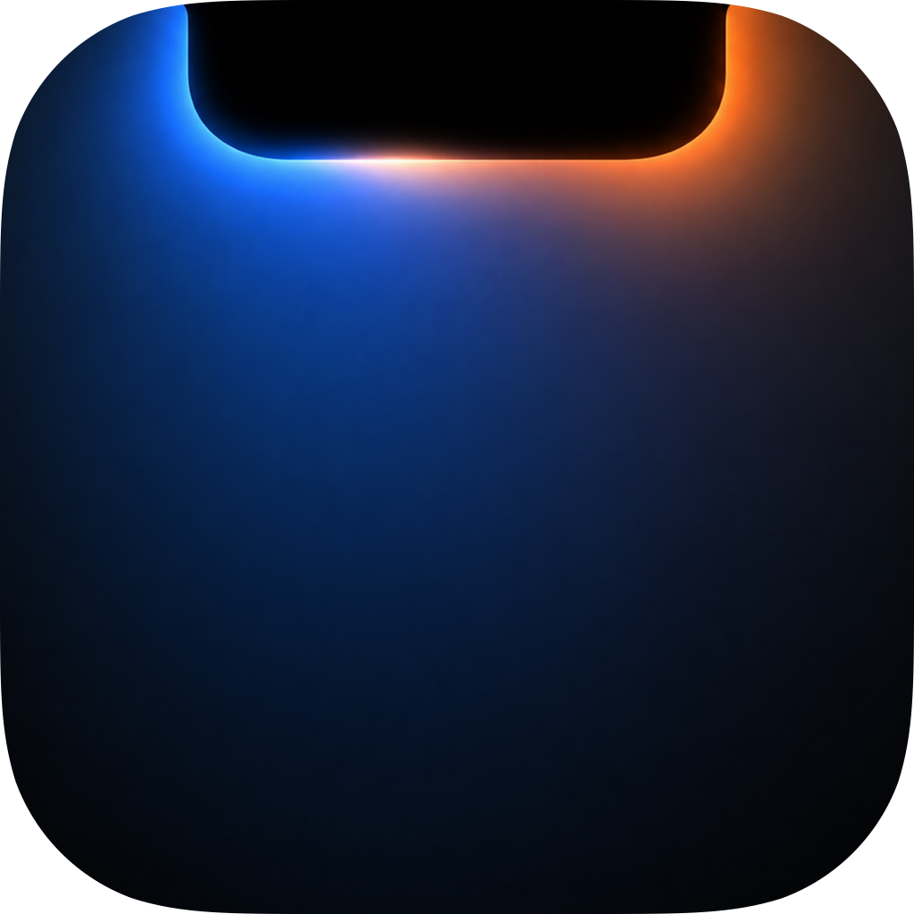
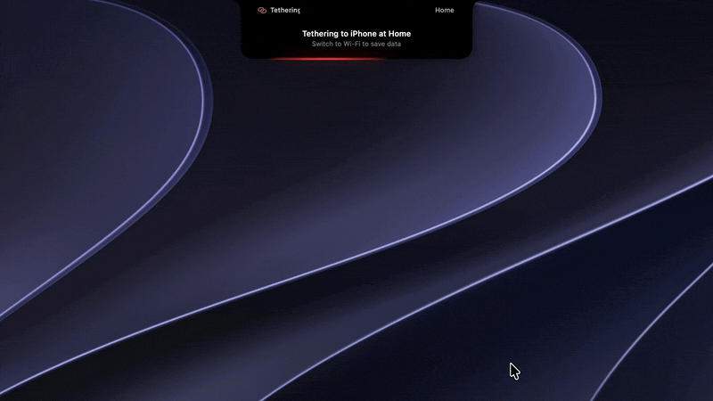

<p align="center">
  
</p>

<h1 align="center">ClangNotch</h1>

<p align="center">
  English · <a href="README.ko.md">한국어</a>
</p>

<p align="center">
  Watch Claude Code and Codex work, right in your Mac's notch.
</p>

<p align="center">
  
</p>

<p align="center">
  
  
</p>

---

ClangNotch sits in the notch and shows what your coding agents are doing: which tool is running, whether a reply has finished, and whether one is waiting on you. It reads the session files Claude Code and Codex already write, so there's nothing to set up.


## Install

Download `ClangNotch.dmg` from [Releases](../../releases) and drag it into your Applications folder.

The app is notarized by Apple, so it opens without a warning. From then on it downloads new versions itself and installs one when you click **Restart to Update** (Settings → About).

Requires macOS 14.2 or later. On a Mac without a notch, it appears in the same shape at the top of the screen.

## Features

**Agents**

- Live status for Claude Code (CLI, desktop app, VS Code) and Codex (CLI, desktop app), read from `~/.claude/projects` and `~/.codex/sessions`
- The closed notch shows the tool that's running, then Done with a checkmark when a turn ends
- When a turn ends, the first line of the reply and how long it took drop down, with Open terminal / Open app to jump to the terminal tab or app the session runs in
- Answer permission requests and `AskUserQuestion` questions from the notch. Codex questions show in the notch and are answered in Codex
- A session waiting on you is announced again every 3, 5 or 10 minutes. The done and waiting sounds stay quiet while the screen is locked
- Sessions grouped by folder. Click one for its session view with each step and the file changes, and jump from there to its terminal or app
- Subagents Claude starts show under their session. Codex sessions go by their thread names from the Codex app
- A context bar at the top of the session view
- 5-hour and weekly usage for Claude and Codex
- Claude Code sessions running on an SSH server (over a reverse tunnel)
- Codex on an SSH server isn't supported yet

**Tools**

Each one is a tab in the open notch, and each can be turned off in Settings.

<p align="center">
  
</p>

- Clipboard history (text only, kept in memory). Items you reuse can be pinned
- Per-app volume
- iPad Sidecar controls
- Quick access to multi-display arrangement
- Battery for your Mac, Bluetooth devices (third-party headsets and keyboards too), iPhone and iPad. Right-click a device to show it in the header or rank it for the closed notch
- A ranked device below 20% (and not charging) shows in the closed notch's wing. Each one can be turned off
- Speed test (Cloudflare's servers), network info, and tethering data usage for SKT (Korea) subscribers only
- Keyboard lock and key test

<p align="center">
  
  
</p>

In the open notch, ⌘1–⌘7 switch tabs.

Once enabled, the volume and brightness keys show ClangNotch's own slider instead of the system one.

- The volume keys also turn down outputs macOS can't, such as HDMI and DisplayPort monitor speakers. Apps whose screen share would pick up the sound can be left out
- If MonitorControl, Lunar or BetterDisplay sets your external display's brightness, the brightness keys can be passed through to it

<p align="center">
  
</p>

Connect AirPods or a Bluetooth headset and a card drops from the notch with its battery. AirPods show the moment the case opens, and with one bud in, only the bud you're wearing. AirPods Max show when you put them on and fold when you take them off.

<p align="center">
  
</p>

**Notch and settings**

- Notch colour: follow the wallpaper, auto, light or dark, a colour taken from a wallpaper photo, or an eyedropper
- Reorder or hide tabs
- How long to wait before opening, haptics on open and on finish, show over full-screen apps
- Battery saver mode with less glow on battery
- Menu bar icon (session count, keyboard lock, settings)
- Settings search, and Check Now in Settings → About

The app's interface is in Korean by default. Switch it to English in **Settings → General → Display language**.

## Permissions

| Permission | Used for |
|---|---|
| Accessibility | Volume and brightness keys, keyboard lock, moving the system overlay |
| Notifications | Low battery alerts |
| Location | Reading the Wi-Fi name (macOS won't share it without location access) |
| Audio capture | Per-app volume |
| Automation (Terminal) | Going to a session's tab, only if the session runs in Terminal |

Approving from the notch adds hooks to `~/.claude/settings.json` and `~/.codex/hooks.json`, and backs up the original files first. Codex only runs a new hook after you trust it once in `/hooks`.

iPhone and iPad battery needs [libimobiledevice](https://libimobiledevice.org). The install button in the Battery tab runs `brew install libimobiledevice` in Terminal.

## Build

```bash
git clone https://github.com/Clang-error/clangnotch.git
cd clangnotch
xcodebuild -project ClangNotch.xcodeproj -scheme ClangNotch -configuration Release build
```

Before building, set the project's Signing team to your own.

## License

[MIT](LICENSE)
